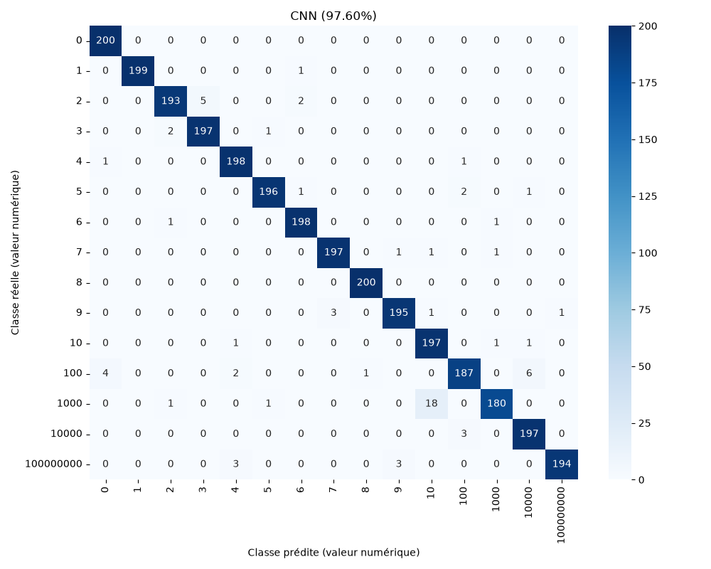
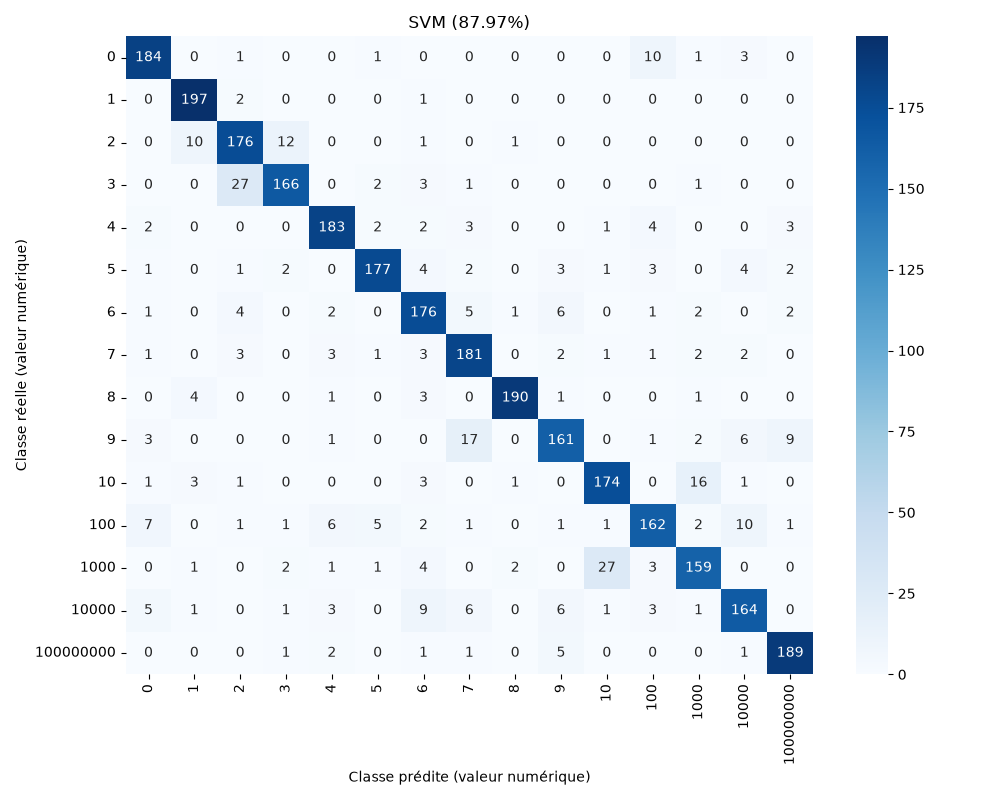
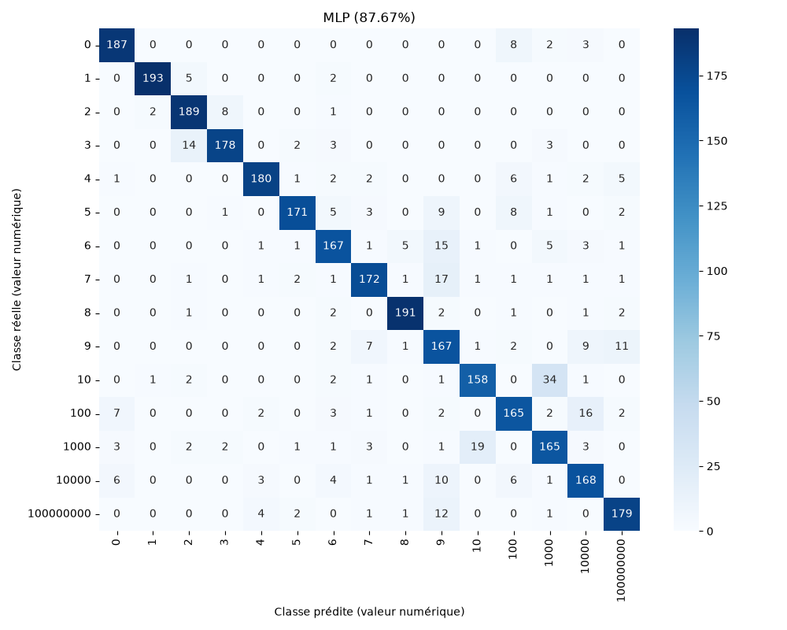

# Chinese MNIST Handwritten Character Classification

Comparative study of Machine Learning and Deep Learning models for classifying handwritten Chinese numerals from the **Chinese MNIST** dataset (15,000 grayscale images across 15 balanced classes: digits `0`–`9` and powers of ten `10`, `100`, `1,000`, `10,000`, `10⁸`).

This project investigates the limitations of flattening 2D images into 1D feature vectors (`1,024` pixels) for classical classifiers (**Random Forest**, **MLP**, **SVM**) and demonstrates the decisive impact of preserving 2D spatial structure with a **Convolutional Neural Network (CNN)**, reaching **97.60% test accuracy**.

---

## Dataset Overview


---

## Key Results (3,000 Test Images)

| Model | Input Shape | Selected Hyperparameters | Training Time | Test Accuracy | Macro F1-Score |
| :--- | :---: | :--- | :---: | :---: | :---: |
| **Random Forest** | 1D (`1024`) | `n_estimators=300`, `max_depth=None`, `max_features=0.1` | 33.0 s | 81.20% | 81.1% |
| **MLP** | 1D (`1024`) | `hidden_layer_sizes=(256, 128)`, `alpha=1e-4`, `lr=0.003` | 14.9 s | 87.67% | 87.8% |
| **SVM (RBF)** | 1D (`1024`) | `kernel='rbf'`, `C=10`, `gamma='scale'` | 35.1 s | 87.97% | 87.9% |
| **CNN (2D)** | 2D (`32×32×1`) | 2×(`Conv2D` + `MaxPool`), `Dense(128)`, `dropout=0.2`, SGD (`lr=0.02`, `batch=32`) | 175.0 s | **97.60%** | **97.6%** |

- **+9.63 percentage points** over the best 1D baseline (SVM at 87.97%).
- **5× fewer misclassifications** on the test set (**72 errors** vs. **361** for SVM).
- Every single class achieves an F1-score **above 0.940** with the 2D CNN.

### Confusion Matrices

#### Best Model — 2D CNN (97.60%)


<details>
<summary>View 1D Baseline Confusion Matrices (SVM, MLP, Random Forest)</summary>

**SVM — RBF Kernel (87.97%)**


**Multi-Layer Perceptron (87.67%)**


**Random Forest (81.20%)**


</details>

---

## Tech Stack

- **Language:** Python 3.11
- **Machine Learning:** `scikit-learn` (Random Forest, MLP, SVM, `GridSearchCV`)
- **Deep Learning:** `Keras` / `TensorFlow` (2D CNN, Mini-batch SGD with momentum)
- **Image Processing & Data:** `Pillow` (32×32 Lanczos downsampling), `NumPy`, `Pandas`
- **Visualization:** `Matplotlib`, `Seaborn`
- **Technical Report:** PDF ([Machine_learning - Rapport - Halepidis_Lion.pdf](../Machine_learning%20-%20Rapport%20-%20Halepidis_Lion.pdf), typeset in LaTeX)

---

## Project Structure

```text
chinese-mnist-classification/
├── projet_ml_halepidis_lion.py                      # Full pipeline: preprocessing, GridSearch, training & evaluation
├── Chinese_MNIST.py                                 # Dataset visualization script (generates apercu_dataset.png)
├── requirements.txt                                 # Python dependencies
├── Machine_learning - Rapport - Halepidis_Lion.pdf  # Final technical report (French)
├── results/                                         # Dataset overview & generated confusion matrices
│   ├── apercu_dataset.png
│   ├── confusion_random_forest.png
│   ├── confusion_mlp.png
│   ├── confusion_svm.png
│   └── confusion_cnn.png
└── .github/
    └── README.md
```

---

## Installation & Usage

1. **Clone the repository:**
   ```bash
   git clone https://github.com/hleo1304/chinese-mnist-classification.git
   cd chinese-mnist-classification
   ```

2. **Create a virtual environment and install dependencies:**
   ```bash
   python -m venv .venv
   # Windows (PowerShell):
   .venv\Scripts\Activate.ps1
   # Linux / macOS:
   source .venv/bin/activate

   pip install -r requirements.txt
   ```

3. **Download the dataset:**
   Download the [Chinese MNIST dataset on Kaggle](https://www.kaggle.com/datasets/gpreda/chinese-mnist), then place `chinese_mnist.csv` and the `data/` folder (containing the 15,000 `.jpg` images) in the project root directory.

4. **Run the full pipeline:**
   ```bash
   python projet_ml_halepidis_lion.py
   ```
   All 4 confusion matrices will be automatically saved inside `results/`.

---

## Authors

- **Léo Halepidis** & **Maxence Lion** — Machine Learning Project (B.Sc. in Engineering, UMONS)
