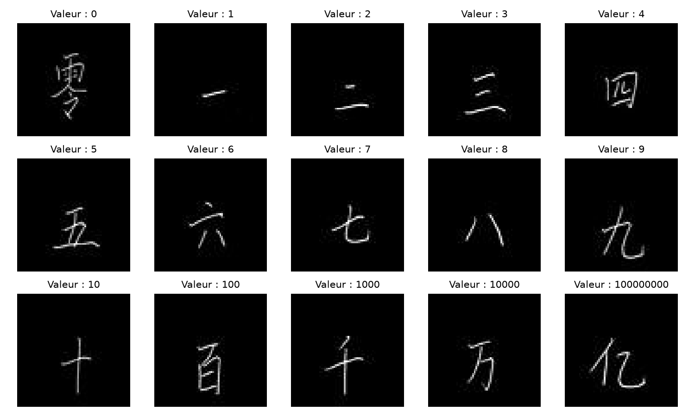

# Classification de caractères chinois manuscrits (Chinese MNIST)

Étude comparative de quatre modèles de Machine Learning et Deep Learning pour la classification d'images en niveaux de gris de nombres manuscrits chinois (15 classes : chiffres de `0` à `9` et puissances de dix `10`, `100`, `1 000`, `10 000`, `10⁸`).

Ce projet met en évidence les limites de l'aplatissement 1D des images sur les classifieurs classiques (**Random Forest**, **MLP**, **SVM**) et démontre le gain apporté par un **réseau de neurones convolutif 2D (CNN)**, atteignant **97,60 % d'accuracy** sur le jeu de test.

---

## Aperçu du dataset



---

## Résultats obtenus (sur 3 000 images de test)

| Modèle | Entrée | Hyperparamètres retenus | Temps d'entraînement | Accuracy test | F1-score macro |
| :--- | :---: | :--- | :---: | :---: | :---: |
| **Random Forest** | 1D (`1024`) | `n_estimators=300`, `max_depth=None`, `max_features=0.1` | 33,0 s | 81,20 % | 81,1 % |
| **MLP** | 1D (`1024`) | `hidden_layer_sizes=(256, 128)`, `alpha=1e-4`, `lr=0.003` | 14,9 s | 87,67 % | 87,8 % |
| **SVM (RBF)** | 1D (`1024`) | `kernel='rbf'`, `C=10`, `gamma='scale'` | 35,1 s | 87,97 % | 87,9 % |
| **CNN (2D)** | 2D (`32×32×1`) | 2×(`Conv2D` + `MaxPool`), `Dense(128)`, `dropout=0.2`, SGD (`lr=0.02`, `batch=32`) | 175,0 s | **97,60 %** | **97,6 %** |

> Le passage de vecteurs 1D à une architecture convolutive 2D divise le nombre d'erreurs par 5 sur le jeu de test (**72 erreurs** contre **361** pour le SVM).

### Matrice de confusion du meilleur modèle (CNN 2D)


---

## Stack technique

- **Langage :** Python 3.11
- **Machine Learning :** `scikit-learn` (Random Forest, MLP, SVM, `GridSearchCV`)
- **Deep Learning :** `Keras` / `TensorFlow` (CNN 2D, SGD avec momentum)
- **Traitement d'images & données :** `Pillow` (redimensionnement 32×32 Lanczos), `NumPy`, `Pandas`
- **Visualisation :** `Matplotlib`, `Seaborn`
- **Rapport scientifique :** LaTeX (`rapport_final.tex`)

---

## Structure du projet

```text
chinese-mnist-classification/
├── projet_ml_halepidis_lion.py   # Pipeline complet : prétraitement, GridSearch, entraînement et évaluation
├── Chinese_MNIST.py              # Script de génération de l'aperçu des 15 classes
├── requirements.txt              # Dépendances Python
├── rapport_final.tex             # Source LaTeX du rapport d'analyse
├── results/                      # Aperçu du dataset et matrices de confusion générées
│   ├── apercu_dataset.png
│   ├── confusion_random_forest.png
│   ├── confusion_mlp.png
│   ├── confusion_svm.png
│   └── confusion_cnn.png
└── .github/
    └── README.md
```

---

## Installation et exécution

1. **Cloner le dépôt :**
   ```bash
   git clone https://github.com/hleo1304/chinese-mnist-classification.git
   cd chinese-mnist-classification
   ```

2. **Créer un environnement virtuel et installer les dépendances :**
   ```bash
   python -m venv .venv
   # Windows (PowerShell) :
   .venv\Scripts\Activate.ps1
   # Linux / macOS :
   source .venv/bin/activate

   pip install -r requirements.txt
   ```

3. **Télécharger les données :**
   Télécharge le jeu de données [Chinese MNIST sur Kaggle](https://www.kaggle.com/datasets/gpreda/chinese-mnist), puis place `chinese_mnist.csv` et le dossier `data/` (contenant les 15 000 images `.jpg`) à la racine du projet.

4. **Lancer le pipeline complet :**
   ```bash
   python projet_ml_halepidis_lion.py
   ```
   Les 4 matrices de confusion seront générées automatiquement dans le dossier `results/`.

---

## Auteurs

- **Léo Halepidis** & **Maxence Lion** — Projet de Machine Learning (Bachelier Ingénieur Civil, UMONS)
