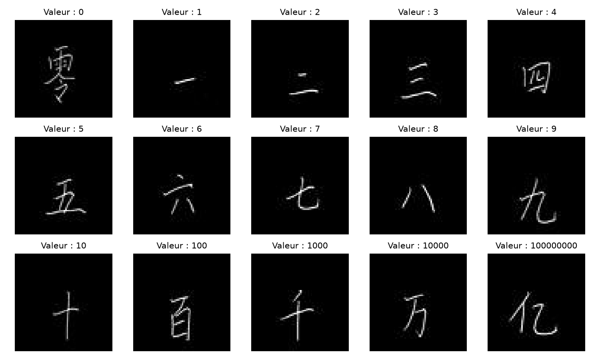
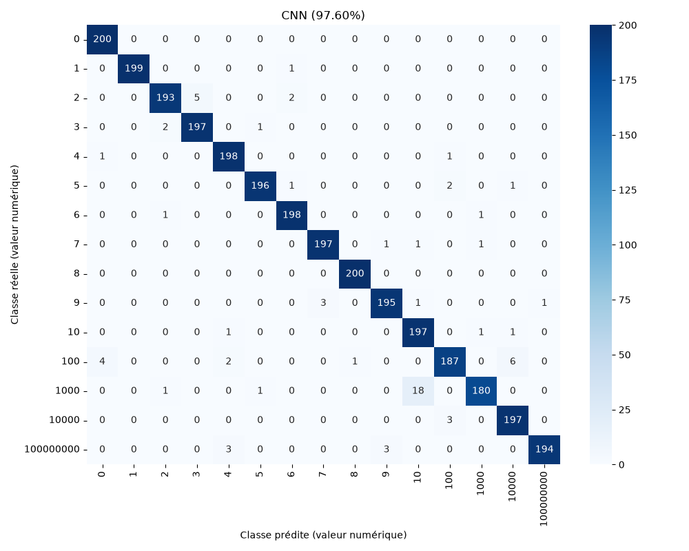
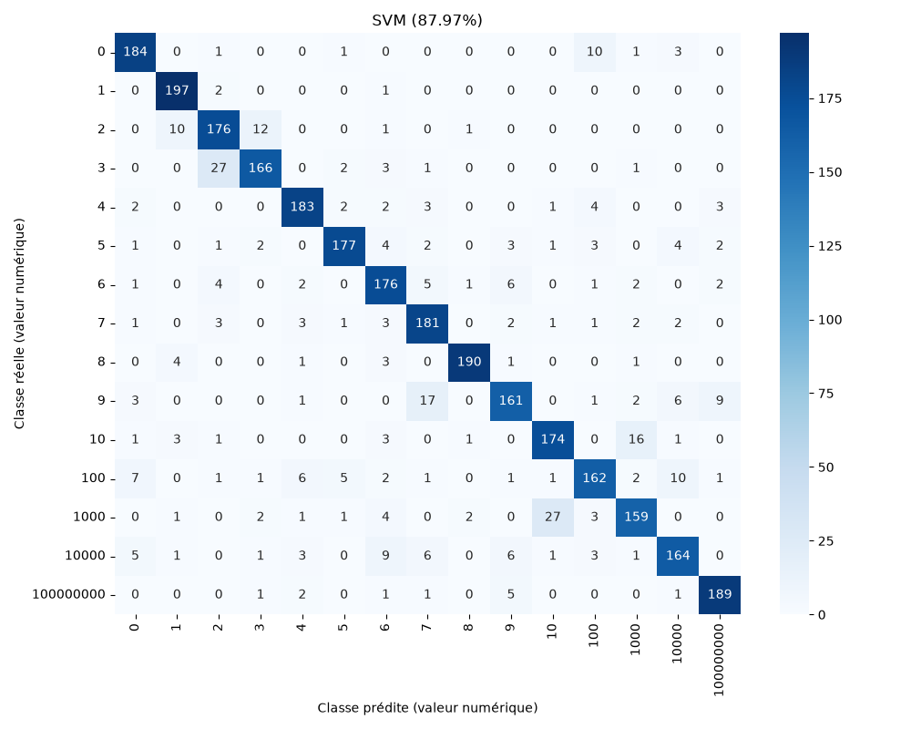
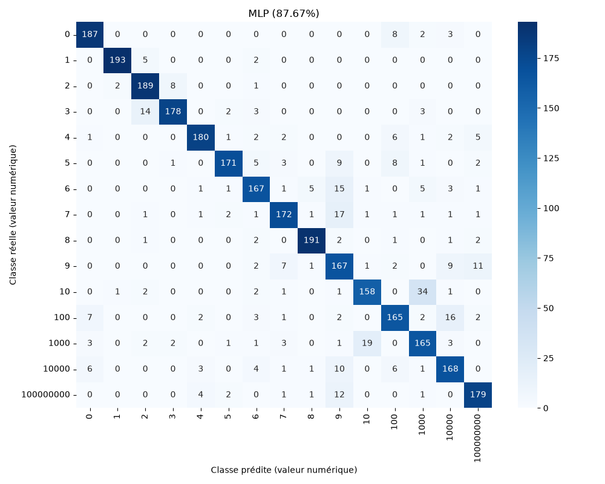

# Chinese MNIST Handwritten Character Classification


Comparative evaluation of three classical 1D models (**Random Forest**, **MLP**, **SVM**) and a 2D **Convolutional Neural Network (CNN)** on the **Chinese MNIST** dataset (15,000 grayscale images, 15 balanced classes). Preserving the 2D spatial grid ($32 \times 32 \times 1$) rather than flattening pixels into 1D vectors ($\mathbb{R}^{1024}$) boosts test accuracy from **87.97%** to **97.60%** and cuts misclassifications by a factor of 5.

📄 **Full Technical Report (French):** [Machine_learning - Rapport - Halepidis_Lion.pdf](Machine_learning%20-%20Rapport%20-%20Halepidis_Lion.pdf)

---

## Methodology & Key Results

All models are trained and evaluated on the exact same stratified split (`seed = 42`): **12,000** training images and **3,000** test images (200 per class). Images are converted to grayscale, downsampled from $64 \times 64$ to $32 \times 32$ using Lanczos resampling, and normalized to $[0, 1]$.

- **Hyperparameter tuning:** conducted on a stratified **3,000-image** training subset to prevent data leakage and keep CPU runtime tractable (3-fold `GridSearchCV` for `scikit-learn` models; 12-combination grid over 12 epochs on an 80/20 validation split for the CNN).
- **1D vs. 2D representation:** Random Forest, MLP, and SVM receive flattened vectors $x \in \mathbb{R}^{1024}$, whereas the CNN processes $32 \times 32 \times 1$ tensors through two `Conv2D` + `MaxPooling2D` blocks before a `Dense(128)` + `Dropout(0.2)` classifier trained with mini-batch SGD (`momentum = 0.9`, 25 epochs).

### Overall Test Performance (3,000 Images)

| Model | Input | Best Hyperparameters | Final Train Time | Test Accuracy | Macro $F_1$ |
| :--- | :---: | :--- | :---: | :---: | :---: |
| **Random Forest** | 1D (`1024`) | `n_estimators=300`, `max_depth=None`, `max_features=0.1` | 33.0 s | 81.20% | 81.1% |
| **MLP** | 1D (`1024`) | `hidden_layer_sizes=(256, 128)`, `alpha=1e-4`, `lr=0.003` | 14.9 s | 87.67% | 87.8% |
| **SVM (RBF)** | 1D (`1024`) | `kernel='rbf'`, `C=10`, `gamma='scale'` | 35.1 s | 87.97% | 87.9% |
| **CNN (2D)** | 2D (`32×32×1`) | `lr=0.02`, `batch_size=32`, `dropout=0.2` (val: 83.83%) | 175.0 s | **97.60%** | **97.6%** |

- **+9.63 percentage points** over the best 1D baseline (SVM at 87.97%, which overfits with 99.18% train accuracy).
- **72 total errors** on the test set with the 2D CNN vs. **361 errors** with the SVM.
- **Hardest classes ($F_1$-score gains SVM $\rightarrow$ CNN):** `9` ($0.836 \rightarrow 0.977$), `10` ($0.857 \rightarrow 0.945$), `100` ($0.835 \rightarrow 0.952$), `1,000` ($0.822 \rightarrow 0.940$), and `10,000` ($0.839 \rightarrow 0.973$).

---

## Visualizations

| Dataset Overview (15 Classes) | Best Model — 2D CNN (97.60%) |
| :---: | :---: |
|  |  |

| SVM — RBF Kernel (87.97%) | MLP (87.67%) |
| :---: | :---: |
|  |  |

---

## Tech Stack & Project Structure

- **Core Stack:** Python 3.11, `scikit-learn`, `Keras`, `TensorFlow`, `Pillow`, `NumPy`, `Pandas`, `Matplotlib`, `Seaborn`

```text
chinese-mnist-classification/
├── projet_ml_halepidis_lion.py                      # Full pipeline: preprocessing, GridSearch, training & evaluation
├── Chinese_MNIST.py                                 # Generates the 15-class dataset overview figure
├── requirements.txt                                 # Python dependencies
├── Machine_learning - Rapport - Halepidis_Lion.pdf  # Final technical report (French)
├── results/                                         # Generated figures & confusion matrices
│   ├── apercu_dataset.png
│   ├── confusion_cnn.png
│   ├── confusion_mlp.png
│   ├── confusion_random_forest.png
│   └── confusion_svm.png
└── README.md
```

---

## Installation & Usage

Download the [Chinese MNIST dataset on Kaggle](https://www.kaggle.com/datasets/gpreda/chinese-mnist) and place `chinese_mnist.csv` + the `data/` folder (15,000 `.jpg` files) in the repository root before running.

```bash
git clone https://github.com/hleo1304/chinese-mnist-classification.git
cd chinese-mnist-classification

python -m venv .venv
# Windows (PowerShell): .venv\Scripts\Activate.ps1
# Linux / macOS:        source .venv/bin/activate

pip install -r requirements.txt

# Optional: generate dataset overview image
python Chinese_MNIST.py

# Run full benchmark (RF, MLP, SVM, 2D CNN) and save confusion matrices to results/
python projet_ml_halepidis_lion.py
```

---

**Authors:** Léo Halepidis & Maxence Lion — Engineering Machine Learning Project (UMONS)
